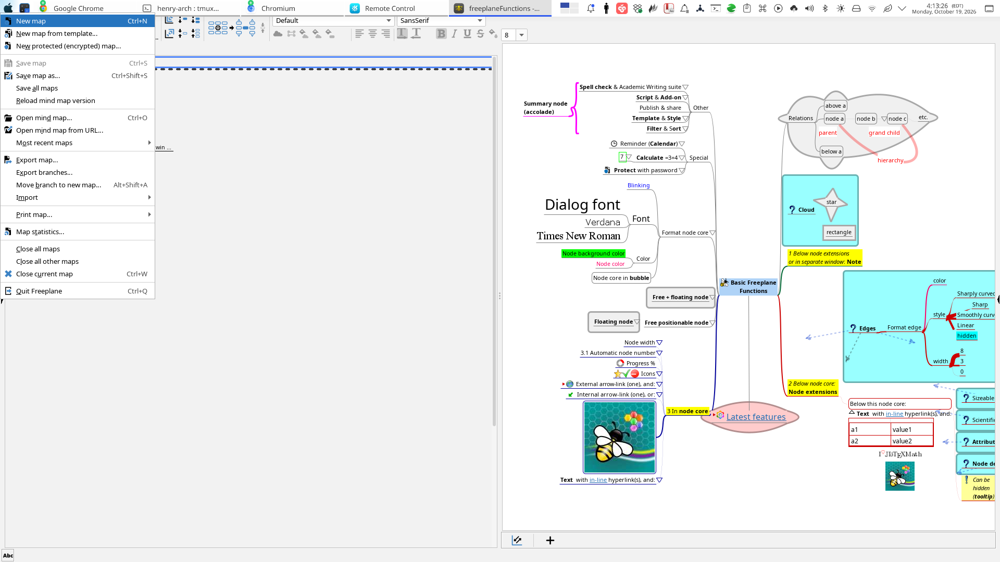
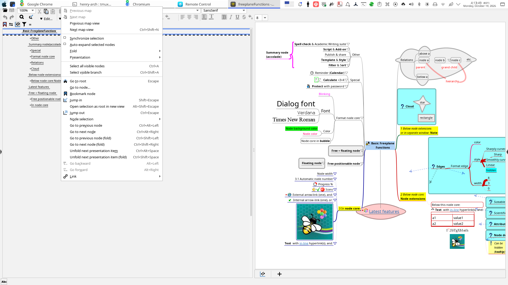

# XWayland popup screenshots

These two archived developer captures were taken on 2026-10-19 in the XWayland
session used during development. The 1920×1080 frame was maximized; the menus were
opened with `Alt+F` and `Alt+N`. The application window and focus had been checked
before capture. They are distinct from the native-X11 tester run documented in
[the native-X11 report](../native-x11-20261019/report.md).

The original screenshots are preserved byte for byte. The desktop panel overlaps
the application menu bar in these full-screen captures; they show the rendered
popup panels and application, and do not independently establish an unobscured
menu-item border or a numeric zero-gap measurement.

| Capture | Surface | Artifact |
| --- | --- | --- |
| File menu | Maximized Freeplane with File popup open | [kbd-file.png](screenshots/kbd-file.png) |
| Navigate menu | Maximized Freeplane with Navigate popup open | [final-nav-max.png](screenshots/final-nav-max.png) |

[provenance.json](provenance.json) records dimensions, byte counts, and SHA-256
values. These captures document the prior UI run. They are not a fresh runtime
test of the later delivery merge.
